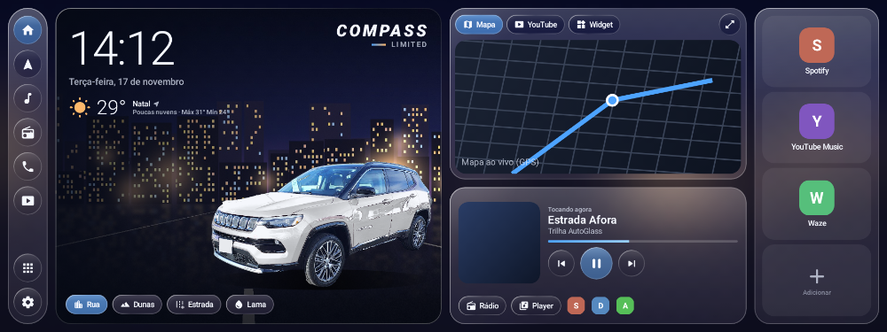
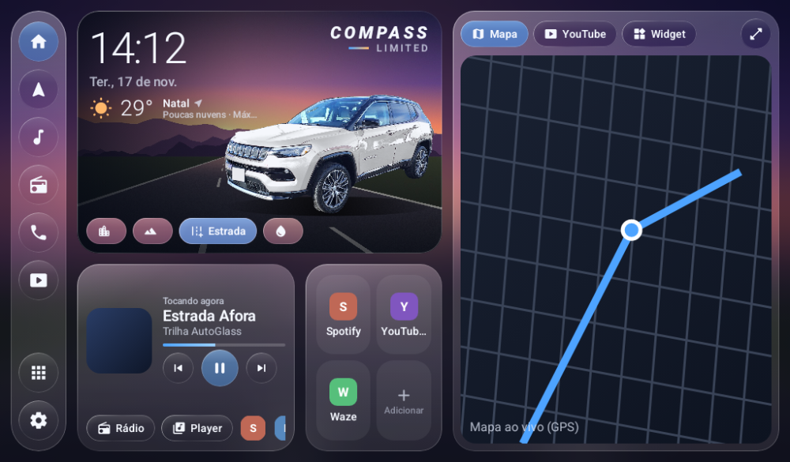
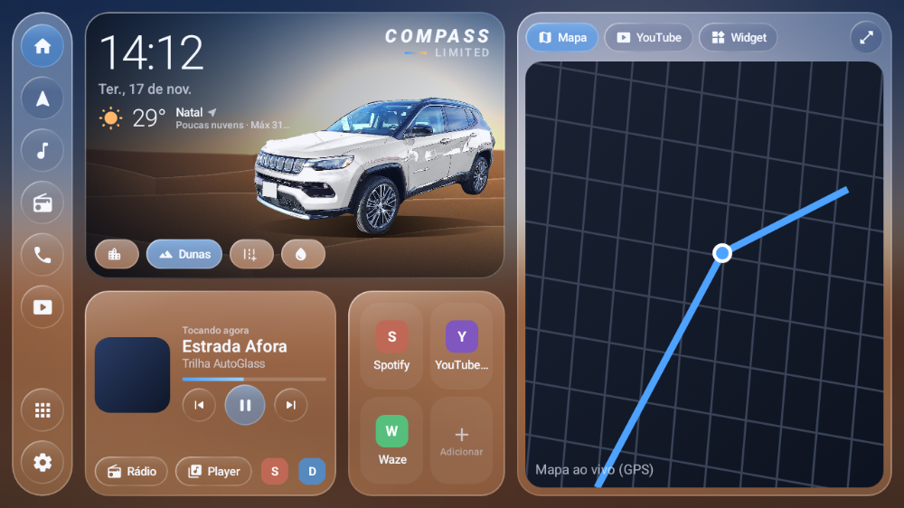

# AutoGlass Launcher

Launcher (tela inicial) para centrais multimídia **Android** de 9" a 15", com visual
*liquid glass* inspirado no CarPlay do iOS 26. Começa configurada para um
**Jeep Compass Limited branco com teto preto e rodas aro 19**.



| 9" 1024x600 | 10" 1280x720 | 15" vertical |
|---|---|---|
|  |  |  |

> As imagens acima são geradas automaticamente no build (Paparazzi). Nelas o mapa
> aparece simulado; no aparelho ele é o mapa real com GPS.

## Baixar e instalar

1. Baixe o APK pronto: [`dist/AutoGlass-1.0.0.apk`](dist/AutoGlass-1.0.0.apk)
   (ou a versão mais nova na aba **Actions → Build APK → Artifacts**).
2. Copie para um pendrive e abra pelo gerenciador de arquivos da central
   (permita "instalar apps de fontes desconhecidas"). Por cabo/Wi-Fi:
   `adb install -r AutoGlass-1.0.0.apk`.
3. Aperte o botão **Home** da central e escolha **AutoGlass → Sempre**.
   Se não aparecer a pergunta: *Configurações do AutoGlass → Definir como tela inicial padrão*.
4. Na primeira abertura, conceda:
   - **Localização**: mapa, GPS e previsão do tempo;
   - **Acesso às mídias** (botão *Permitir* no cartão de música): mostra música,
     capa e progresso do Spotify, YouTube Music, Deezer, Amazon Music, rádio etc.;
   - opcional, **Sobrepor a outros apps**: botão Home flutuante.

Requisitos: Android 7.0 ou mais novo (FYT/SYU, MTCD/Microntek, TS, Topway e
outras centrais "Android Auto Radio").

## O que tem na tela

| Área | Função |
|---|---|
| **Cartão do veículo** | Foto do Compass sobre o ambiente escolhido: **Rua, Dunas, Estrada ou Lama**. Relógio, data e previsão do tempo (cidade, temperatura, máx/mín). |
| **Painel ao vivo** | **Mapa** interativo com GPS (arrastar, pinça, centralizar), **YouTube** tocável dentro do painel ou um **Widget** de qualquer app (Google Maps, Spotify, rádio da central…). **Dois toques** abrem o app real em tela cheia (Waze/Google Maps, YouTube). Volte com o botão Home. |
| **Cartão de música** | Mostra e controla o que estiver tocando (anterior, play/pause, próxima, progresso). Atalhos para **Rádio** e **Player da central** e para os apps de música instalados. |
| **4 apps fixos** | Escolha até 4 apps (ex.: Spotify, YouTube Music, Deezer, Prime Video). Toque longo troca ou remove. |
| **Barra lateral** | Navegação, Música, Rádio, Telefone/Bluetooth, Vídeo, Todos os apps, Configurações. **Toque longo** escolhe qual app cada botão abre. |

O layout se adapta sozinho:

- telas largas (1920x720, 1280x480): 3 colunas, como no CarPlay;
- 16:9 e 16:10 (1024x600, 1280x720, 1920x1080, 2000x1200): 2 colunas;
- telas em pé (estilo Tesla): coluna única com barra embaixo.

A escala é calculada pelo menor lado da tela, e em *Configurações → Tela* há um ajuste fino de 75% a 135%.

## Personalizar

Em **Configurações**:

- **Veículo**: troque a foto (de preferência um PNG com fundo transparente) e o nome/versão.
- **Ambiente**: escolha o fundo padrão ou use uma foto sua para cada modo.
- **Apps da central**: defina o app de navegação, música, rádio, player, vídeo e telefone.
  O app já detecta sozinho os pacotes mais comuns (Waze, Google Maps, Spotify,
  YouTube Music, Deezer, Amazon Music, rádios `com.syu.radio`, `com.microntek.radio`,
  `com.android.fmradio` etc.).
- **Painel ao vivo**: mapa claro ou escuro, escolha do widget, modo janela.
- **Tela**: tela cheia, relógio 24 h, tamanho da interface.
- **Botão Home flutuante**: uma bolha de vidro sobre os outros apps que volta ao launcher com um toque.

### Apps em janela sobre o painel (opcional)

O Android não deixa um app desenhar outro app dentro dele. Por isso o painel usa um mapa
próprio (OpenStreetMap) e a versão web do YouTube, e o app real abre ao dar dois toques.
Se a sua central tiver **janelas de formato livre**, ative em *Opções do desenvolvedor*:

1. **Forçar atividades a serem redimensionáveis**;
2. **Ativar janelas de formato livre**;

e no AutoGlass ligue *Abrir apps em janela sobre o painel*. Aparece um botão de janela
no painel, que abre o Waze, o Google Maps ou o YouTube **reais** no espaço do painel.

## Limites conhecidos

- Comandos do carro (ar-condicionado, câmera, configurações do veículo) dependem do protocolo
  CAN de cada fabricante de central e não são acessíveis por um app comum. Use os apps de
  fábrica pela gaveta de apps.
- Previsão do tempo e mapa precisam de internet (roteador do celular ou chip na central).
- Para atualizar, instale o APK novo por cima: os dois são assinados com a mesma chave
  de desenvolvimento (`keystore/`). Antes de distribuir publicamente, troque por uma chave própria.

## Compilar

```bash
./gradlew assembleRelease            # APK em app/build/outputs/apk/release/
./gradlew :app:recordPaparazziDebug  # regenera as imagens de tela
```

Projeto em Kotlin + Jetpack Compose. Estrutura:

```
app/src/main/java/com/fbadv/autoglass/
  MainActivity.kt          tela inicial (HOME), modo imersivo, ciclo de vida
  data/                    configurações, lista de apps, pacotes conhecidos
  media/                   sessões de mídia (o que está tocando + controles)
  weather/                 previsão (Open-Meteo) e GPS
  launch/                  abrir apps em tela cheia ou em janela (freeform)
  widget/                  hospedagem de widgets
  overlay/                 botão Home flutuante
  ui/                      telas, efeito de vidro, cartões e painéis
tools/                     scripts que geraram a foto branca e os ambientes
```

## Créditos

- Foto do veículo: "22 Jeep Compass Limited", por HJUdall, Wikimedia Commons,
  **CC0 (domínio público)**. Recortada e repintada digitalmente em branco
  (original vermelho, mesma versão Limited com teto preto e rodas aro 19).
- Ambientes Rua, Dunas, Estrada e Lama: ilustrações geradas por `tools/generate_scenes.py`.
- Mapas © OpenStreetMap contributors © CARTO. Previsão: Open-Meteo.com (CC BY 4.0).
- Jeep e Compass são marcas de seus respectivos titulares. Este é um projeto pessoal,
  sem vínculo com a fabricante.
