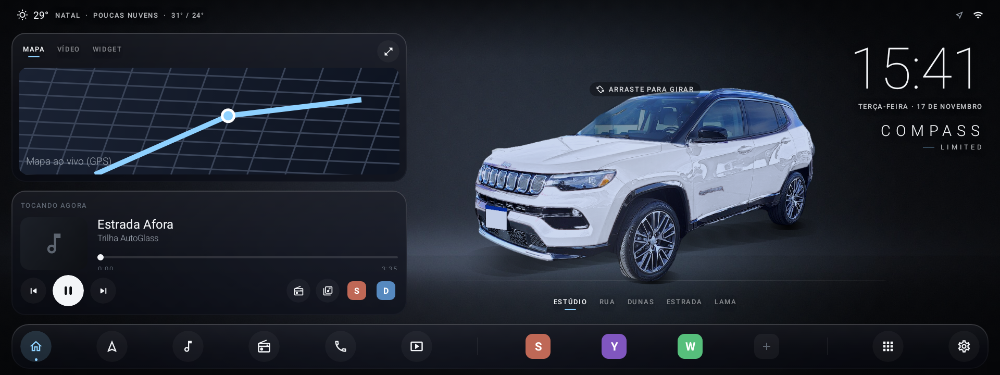
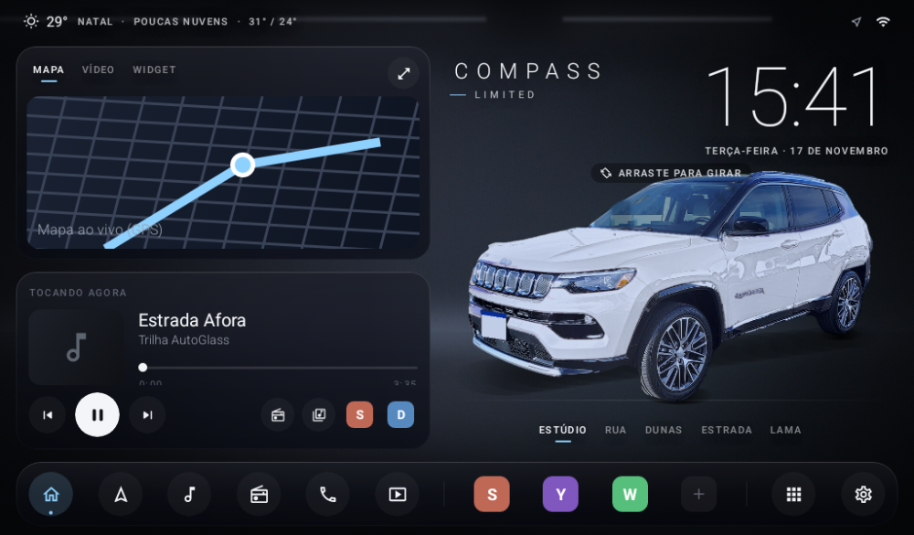
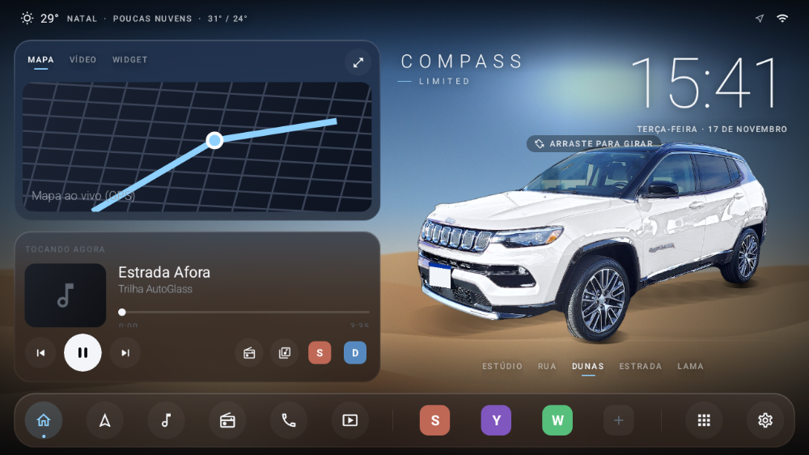
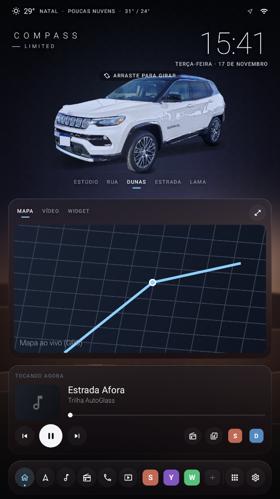
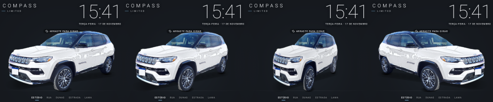

# AutoGlass Launcher

Launcher (tela inicial) para centrais multimídia **Android** de 9" a 15", com visual
premium no estilo das centrais de veículos modernos: fundo grafite, o carro em um
"palco" com reflexo no piso, tipografia fina, painéis em vidro fumê e uma única cor
de destaque. Começa configurada para um **Jeep Compass Limited branco com teto
preto e rodas aro 19**.



| 9" 1024x600 | 10" 1280x720 | 15" vertical |
|---|---|---|
|  |  |  |

> As imagens acima são geradas automaticamente no build (Paparazzi). Nelas o mapa
> aparece simulado; no aparelho ele é o mapa real com GPS.

## Baixar e instalar

1. Baixe o APK pronto: [`dist/AutoGlass-1.3.0.apk`](dist/AutoGlass-1.3.0.apk)
   (ou a versão mais nova na aba **Actions → Build APK → Artifacts**).
2. Copie para um pendrive e abra pelo gerenciador de arquivos da central
   (permita "instalar apps de fontes desconhecidas"). Por cabo/Wi-Fi:
   `adb install -r AutoGlass-1.3.0.apk`.
3. Na primeira abertura o Android pergunta se o **AutoGlass deve ser o app de tela
   inicial padrão** — confirme. A partir daí ele é a tela principal: aparece ao ligar
   a central e ao tocar em Home. (Se não perguntar: *Configurações → Permissões e
   sistema → Tela inicial padrão*. Algumas centrais FYT/SYU escolhem o launcher nas
   *Configurações de fábrica*.)
4. Na primeira abertura, conceda:
   - **Localização**: mapa, GPS e previsão do tempo;
   - **Acesso às mídias** (botão *Permitir controle* no cartão de música): sem ele o
     Android não deixa o launcher comandar Spotify/YouTube Music — os botões viram
     "teclas de mídia", que muitas centrais desviam para o player de fábrica.
     No **Android 13+** apps instalados por APK têm essa opção bloqueada: antes, abra
     *Informações do app → menu ⋮ → Permitir configurações restritas*, depois
     *Acesso a notificações → AutoGlass*. O próprio cartão mostra esse passo a passo;
   - **Sobrepor a outros apps**: permite abrir o AutoGlass sozinho quando a central
     liga ou acorda (Android 10+) e o botão Home flutuante.

Requisitos: Android 7.0 ou mais novo (FYT/SYU, MTCD/Microntek, TS, Topway e
outras centrais "Android Auto Radio").

## O que tem na tela

| Área | Função |
|---|---|
| **Barra de status** | Previsão do tempo (cidade, condição, máx/mín) e estado da conexão. |
| **Palco do veículo** | O Compass com sombra de contato no piso e luz de destaque, sobre o ambiente escolhido: **Estúdio, Rua, Dunas, Estrada ou Lama**. Cada ambiente tem versão de **dia e de noite**, trocada automaticamente pelo nascer/pôr do sol; quando chove no local, aparece **chuva animada**; à noite o carro recebe uma luz mais fria. Relógio grande e data. |
| **Painel ao vivo** | **Mapa** interativo com GPS (arrastar, pinça, centralizar), **YouTube** tocável dentro do painel ou um **Widget** de qualquer app (Google Maps, Spotify, rádio da central…). **Dois toques** abrem o app real em tela cheia (Waze/Google Maps, YouTube). Volte com o botão Home. |
| **Cartão de música** | Mostra e controla o que estiver tocando (anterior, play/pause, próxima). A **barra de progresso pode ser tocada/arrastada** para avançar ou voltar. ▶ sem nada tocando retoma a última música; se não houver, abre o YouTube Music. Atalhos para **Rádio**, **Player da central** e apps de música. |
| **Dock** | Navegação, Música, Rádio, Telefone/Bluetooth e Vídeo (**toque longo** escolhe o app de cada botão), até **4 apps fixos** (ex.: Spotify, YouTube Music, Deezer, Prime Video) e acesso a todos os apps e às configurações. |

O layout se adapta sozinho:

- paisagem (1024x600, 1280x720, 1920x720, 1920x1080, 2000x1200): mapa e mídia à esquerda, veículo e relógio à direita;
- telas em pé (estilo Tesla): palco, mapa e mídia empilhados.

A escala é calculada pelo menor lado da tela, e em *Configurações → Tela* há um ajuste fino de 75% a 135%.

## Girar o veículo

Arraste o carro para os lados: ele gira com inércia e volta sozinho à posição depois
de alguns segundos.



- Com a foto padrão (uma única foto), o giro é um efeito 3D entre os dois lados do
  carro (frente-esquerda ↔ frente-direita).
- Para um **360° completo** (frente, lateral, traseira), use *Configurações → Veículo →
  Fotos 360°* e selecione de 24 a 36 PNGs sem fundo, tirados ao redor do carro em
  intervalos iguais e na ordem do giro. (Tire as fotos com o celular na mesma altura,
  dando a volta no carro; o recorte do fundo pode ser feito com
  `tools/finalize_vehicle.py` ou qualquer removedor de fundo.)

## Personalizar

Em **Configurações**:

- **Veículo**: troque a foto (de preferência um PNG com fundo transparente) e o nome/versão.
- **Cor de destaque**: Azul gelo, Champagne, Vermelho ou Platina.
- **Ambiente**: escolha o fundo padrão ou use uma foto sua para cada modo.
- **Apps da central**: defina o app de navegação, música, rádio, player, vídeo e telefone.
  O botão **Música** abre o **YouTube Music** (YouTube Premium) por padrão; sem ele, o YouTube.
  O app já detecta sozinho os pacotes mais comuns (Waze, Google Maps, Spotify,
  YouTube Music, Deezer, Amazon Music, rádios `com.syu.radio`, `com.microntek.radio`,
  `com.android.fmradio` etc.).
- **Painel ao vivo**: mapa claro ou escuro, escolha do widget, modo janela.
- **Tela**: tela cheia, relógio 24 h, tamanho da interface.
- **Botão Home flutuante**: uma bolha de vidro sobre os outros apps que volta ao launcher com um toque.

### Apps em janela sobre o painel (opcional)

O Android não deixa um app desenhar outro app dentro dele. Por isso o painel usa um mapa
próprio (OpenStreetMap) e a versão web do YouTube, e o app real abre ao dar dois toques.
O mapa usa o **OpenStreetMap**, gratuito e **sem chave de API** (precisa só de internet);
o modo escuro é um filtro aplicado ao mapa.

Se a sua central tiver **janelas de formato livre**, ative em *Opções do desenvolvedor*:

1. **Forçar atividades a serem redimensionáveis**;
2. **Ativar janelas de formato livre**;

e no AutoGlass ligue *Abrir apps em janela sobre o painel*. Aparece um botão de janela
no painel, que abre o Waze, o Google Maps ou o YouTube **reais** no espaço do painel.

## Limites conhecidos

- Comandos do carro (ar-condicionado, câmera, configurações do veículo) dependem do protocolo
  CAN de cada fabricante de central e não são acessíveis por um app comum. Use os apps de
  fábrica pela gaveta de apps.
- Previsão do tempo e mapa precisam de internet (roteador do celular ou chip na central).
- Para atualizar, instale o APK novo por cima: os dois são assinados com a mesma chave
  de desenvolvimento (`keystore/`). Antes de distribuir publicamente, troque por uma chave própria.

## Compilar

```bash
./gradlew assembleRelease            # APK em app/build/outputs/apk/release/
./gradlew :app:recordPaparazziDebug  # regenera as imagens de tela
```

Projeto em Kotlin + Jetpack Compose. Estrutura:

```
app/src/main/java/com/fbadv/autoglass/
  MainActivity.kt          tela inicial (HOME), modo imersivo, ciclo de vida
  data/                    configurações, lista de apps, pacotes conhecidos
  media/                   sessões de mídia (o que está tocando + controles)
  weather/                 previsão (Open-Meteo) e GPS
  launch/                  abrir apps em tela cheia ou em janela (freeform)
  widget/                  hospedagem de widgets
  overlay/                 botão Home flutuante
  ui/                      telas, efeito de vidro, cartões e painéis
tools/                     scripts que geraram a foto branca e os ambientes
```

## Créditos

- Foto do veículo: "22 Jeep Compass Limited", por HJUdall, Wikimedia Commons,
  **CC0 (domínio público)**. Recortada e repintada digitalmente em branco
  (original vermelho, mesma versão Limited com teto preto e rodas aro 19),
  com adesivos do para-brisa removidos, vidros levemente escurecidos, bordas do recorte refinadas e placa Mercosul sem caracteres. Scripts: `tools/recolor_vehicle.py` e `tools/finalize_vehicle.py`.
  Script: `tools/recolor_vehicle.py`.
- Ambientes Estúdio, Rua, Dunas, Estrada e Lama: gerados por `tools/generate_scenes.py`.
- Mapas © OpenStreetMap contributors. Previsão: Open-Meteo.com (CC BY 4.0).
- Jeep e Compass são marcas de seus respectivos titulares. Este é um projeto pessoal,
  sem vínculo com a fabricante.
